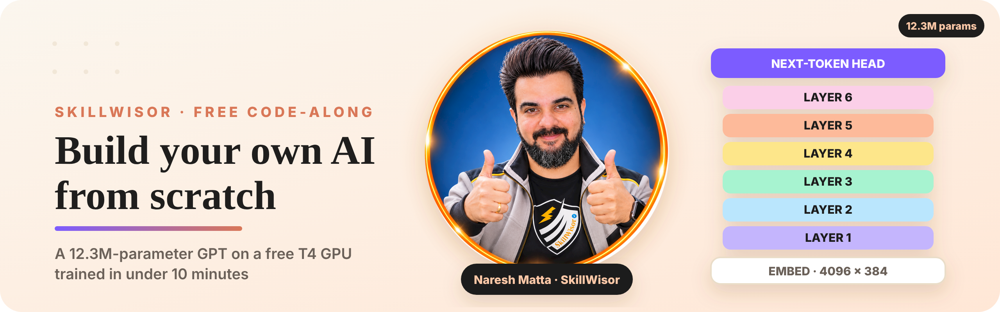
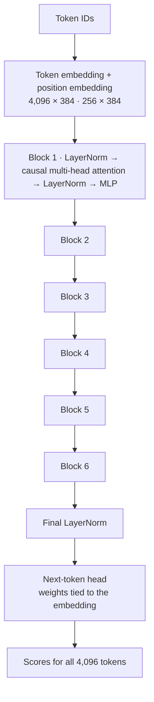

<div align="center">



<br/>

[](https://colab.research.google.com/github/inareshmatta/SkillWisor_Build_Your_Own_SLM_from_scratch/blob/main/SkillWisor_Build_Your_Own_SLM_from_scratch.ipynb)
&nbsp;


**Train a tiny GPT that writes children's stories, from an empty notebook, on a free GPU.**<br/>
Every line of code has a plain-English comment. It's written for software engineers who are new to AI.

</div>

---

## ✨ What you'll build


A **small language model (SLM)**: a decoder-only transformer in the GPT style, with **12.3 million parameters**. You train it from zero on [TinyStories](https://huggingface.co/datasets/roneneldan/TinyStories). Then you teach it to follow instructions, test it, and shrink it 4× so you can share it.

```text
Prompt  ▸  Once upon a time, a little robot
Model   ▸  Once upon a time, a little robot named Mr. Bear was very independent.
           He had many friends who liked to play with him and the other animals…
```

> Written by the model in this notebook after **under 10 minutes** of training on a free Colab T4.

## 🧭 The pipeline


This is the same recipe the big labs follow. The difference is scale: more data, a bigger model and longer training.

## 🏗️ Which architecture, and why?


| Family | Examples | How it reads | Best at |
|---|---|---|---|
| RNN / LSTM | early seq2seq | one word at a time, with a carried memory | historical; slow to train, forgets long text |
| Encoder-only | BERT | the whole sentence, both directions | understanding: search, classification, spam |
| Encoder-decoder | T5, the original transformer | one half reads, the other writes | translation, summarisation |
| **Decoder-only** ⭐ | **GPT, Llama, Gemma, Phi** | **looks back only and predicts the next token** | **writing, chat, code** |
| Mixture of experts | Mixtral, DeepSeek | a router sends each token to a few expert networks | huge capacity at a lower cost per token |
| State-space | Mamba | step by step, but efficiently | very long sequences |

**We build a decoder-only transformer.** It's the simplest architecture that can really write, and almost every chat model today uses this shape.



| Setting | Value | What it means |
|---|---|---|
| `vocab` | 4,096 | how many tokens the model knows |
| `d` | 384 | the width: size of each token's vector |
| `layers` | 6 | how many transformer blocks are stacked |
| `heads` | 6 | parallel attention "lookups" per block |
| `ctx` | 256 | the context window: the most tokens it reads at once |
| parameters | **12.3M** | weight tying saves about 1.5M |

## 📊 Real results from the free T4 run


| Stage | Result |
|---|---|
| GPU | Tesla T4 · 15 GB |
| Data | 2,119,719 stories → **292,604** cleaned train / 5,000 validation |
| Tokens | **64,905,081** training tokens |
| Pretraining | 3,000 steps · loss **8.37 → 1.92** · val **2.00** · **577 s** |
| Instruction tuning (SFT) | 24,424 pairs · 1,500 steps · loss 1.95 → 1.54 |
| Follows the instruction | **40% → 94%** across 10 topics |
| Final eval | val loss 2.31 · perplexity **10.2** |
| Quantization | **55.6 MB → 14.0 MB** (int8), still writes stories |

<details>
<summary><b>Training log</b></summary>

```text
step     0 | train 8.37 | val 8.24 | 4s
step   500 | train 2.87 | val 2.86 | 85s
step  1000 | train 2.32 | val 2.39 | 183s
step  1500 | train 2.07 | val 2.17 | 281s
step  2000 | train 1.95 | val 2.06 | 380s
step  2500 | train 1.99 | val 2.01 | 478s
step  3000 | train 1.92 | val 2.00 | 577s
```

Validation loss stays close to training loss, so the model learned rather than memorised.
</details>

## 🗺️ Notebook walkthrough

| # | Step | What you learn | Key tools |
|---|---|---|---|
| 1 | **Free AI lab** | get a GPU and pick `cuda` or `cpu` | `nvidia-smi`, `torch.cuda` |
| 2 | **Get the data** | load a dataset in one line; where else to find data | `datasets.load_dataset` |
| 3 | **Clean the data** | filter short or broken text, dedupe with MD5 fingerprints, split train/val | `hashlib`, sets |
| 4 | **Tokenizer** | train byte-level BPE from scratch; encode 65M tokens fast | `tokenizers`, NumPy `uint16` |
| 5 | **Build the brain** | transformer block, causal mask, residuals, weight tying | `nn.MultiheadAttention`, `torch.triu` |
| 6 | **Pretrain** | the next-token game, loss, AdamW, OneCycle LR, fp16 | `autocast`, `GradScaler`, `clip_grad_norm_` |
| 7 | **Talk to it** | the generation loop with temperature and top-k | `softmax`, `multinomial` |
| 8 | **Instruction tuning** | SFT pairs, `-100` label masking, avoiding catastrophic forgetting | `ignore_index=-100` |
| 9 | **Test it** | validation loss, perplexity, a task-level pass rate | `math.exp` |
| 10 | **Shrink & share** | manual int8 quantization, upload to the Hub | `state_dict`, `huggingface_hub` |

## 🚀 Quick start


**Google Colab (recommended)**
1. Click **Open in Colab** above.
2. `Runtime → Change runtime type → T4 GPU`.
3. `Runtime → Run all` (Ctrl+F9). The whole run takes about 15–20 minutes.

**Kaggle**
1. Create a new notebook → `File → Import Notebook` → paste this repo's notebook URL.
2. `Settings → Accelerator → GPU T4`, and turn **Internet** on.
3. Run all.

**Locally** (an NVIDIA GPU is recommended)
```bash
pip install torch datasets tokenizers numpy huggingface_hub
jupyter notebook SkillWisor_Build_Your_Own_SLM_from_scratch.ipynb
```

> 💡 Free Colab sessions can disconnect when idle. Save checkpoints to Google Drive if you extend training.

## 🧪 Make it your own


- **Your own data:** swap TinyStories for any text dataset on the Hugging Face Hub, Kaggle, Project Gutenberg or Wikipedia. Check the licence first.
- **Bigger brain:** raise `d`, `layers` or `heads`, then train for more steps.
- **Longer memory:** increase `ctx`. It costs more memory and compute.
- **Creative dial:** try `temperature` 0.3 (safe, repetitive) and 1.2 (wild, more mistakes).
- **New skills:** write your own instruction → answer pairs for SFT.

## 🎬 Watch the video

This notebook goes with the **SkillWisor** video *Build your own AI from scratch*, and its 13 standalone Shorts. They explain every function and parameter with animations, code walkthroughs and the real screens from this run.

## 📚 Credits & further reading

- **TinyStories** by Ronen Eldan and Yuanzhi Li (Microsoft Research): [paper](https://arxiv.org/abs/2305.07759) · [dataset](https://huggingface.co/datasets/roneneldan/TinyStories)
- *Attention Is All You Need* by Vaswani et al., 2017: [paper](https://arxiv.org/abs/1706.03762)
- Andrej Karpathy's nanoGPT, a great next step: [repo](https://github.com/karpathy/nanoGPT)
- [PyTorch](https://pytorch.org) · [Hugging Face datasets](https://huggingface.co/docs/datasets) · [tokenizers](https://huggingface.co/docs/tokenizers)

---

<div align="center">


**Made with ❤️ by Naresh Matta · SkillWisor**: AI explained for engineers.

Questions or your model's best story? Connect on [**LinkedIn**](https://www.linkedin.com/in/inareshmatta) ⭐ Star the repo if it helped you!

</div>
